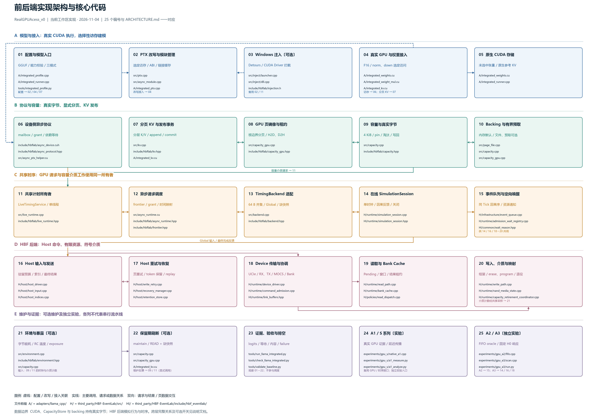

# 前后端架构与编号说明

更新时间：2026-11-04。依据当前工作区源代码，包含已有未提交的实现。“前端”指 CUDA/llama.cpp 执行与接入层，“后端”指 HBF-EventLab 离散事件模拟层，不是 Web 前后端。



[原尺寸 PNG](architecture.png) · [可缩放 SVG](architecture.svg) · [矢量 PDF](architecture.pdf)。25 个功能方框均有唯一编号；彩色分区标题只用于分层。图中只画主要关系，完整交互见下文。

## 1. 主链路与数据边界

```text
配置 01 → 权重/PTX 接入 02、04 → 协议 06 → 共享服务 11
KV 07 ↔ GPU 页 08 ↔ CapacityStore 09 → 共享服务 11
                         ↕                  ↓
                     backing 10       AsyncRuntime 12
                                            ↓
TimingBackend 13 → Session 14 → Host 16 → Device 18 → 读 19 / 写 20
       ↑                        ↓
       └──── 最终 Global 结果 ────┘ → 父请求完成 → 06 解除依赖
```

- **真实数据**由 CUDA 分配、GPU 页镜像、CapacityStore 脏页与 backing 按租约/写回状态持有，H2D/D2H 是真实传输。
- **模拟行为与时序**由 13～20 负责。DataToken 是符号内容证据，不是 payload 或页哈希，后端不向 GPU 返回模型计算字节。
- **独立预算**包括 GPU frame、前端父请求数、Host resident_fragments、Device MOCS；活动预算不限制全部历史记录内存。
- **时间解释**保留 GPU readiness/timestamp 驱动策略；程序墙钟不能直接作为物理 HBF 的 TTFT/TPOT 或吞吐预测。

## 2. 编号索引

| 编号 | 方框 | 分层 |
|---|---|---|
| 01 | [配置与模型入口](#module-01) | 模型与接入 |
| 02 | [PTX 改写与模块管理](#module-02) | 模型与接入 |
| 03 | [Windows 注入〔可选〕](#module-03) | 模型与接入 |
| 04 | [真实 GPU 与权重接入](#module-04) | 模型与接入 |
| 05 | [原生 CUDA 存储](#module-05) | 模型与接入 |
| 06 | [设备侧异步协议](#module-06) | 协议与容量 |
| 07 | [分页 KV 与发布事务](#module-07) | 协议与容量 |
| 08 | [GPU 页镜像与租约](#module-08) | 协议与容量 |
| 09 | [容量与真实字节](#module-09) | 协议与容量 |
| 10 | [Backing 与有界预取](#module-10) | 协议与容量 |
| 11 | [共享计时所有者](#module-11) | 共享时序 |
| 12 | [异步请求调度](#module-12) | 共享时序 |
| 13 | [TimingBackend 适配](#module-13) | 共享时序 |
| 14 | [在线 SimulationSession](#module-14) | 共享时序 |
| 15 | [事件队列与定向唤醒](#module-15) | 共享时序 |
| 16 | [Host 输入与发送](#module-16) | HBF 后端 |
| 17 | [Host 重试与恢复](#module-17) | HBF 后端 |
| 18 | [Device 传输与协调](#module-18) | HBF 后端 |
| 19 | [读取与 Bank Cache](#module-19) | HBF 后端 |
| 20 | [写入、介质与映射](#module-20) | HBF 后端 |
| 21 | [环境与暴露〔可选〕](#module-21) | 维护与证据 |
| 22 | [保留期刷新〔可选〕](#module-22) | 维护与证据 |
| 23 | [证据、验收与排空](#module-23) | 维护与证据 |
| 24 | [A1 / S 系列〔实验〕](#module-24) | 维护与证据 |
| 25 | [A2 / A3〔独立实验〕](#module-25) | 维护与证据 |

图中 A/、H/、HI/ 为节省空间的前缀；以下核心代码提供完整仓库相对路径及链接。

## 3. 每个方框的实现说明

<a id="module-01"></a>
### 01　配置与模型入口

从真实 GGUF 元数据和转换记录生成 profile，核对模型身份、形状、上下文及容量预算，装配 llama.cpp 并保存 token、logits 和摘要。为 02、04、07 提供配置。native 为原生参考；bypass 保留分页但绕过介质计时；modeled 启用后端计时。

**核心代码**：

- [adapters/llama_cpp/integrated_profile.cpp](../adapters/llama_cpp/integrated_profile.cpp)
- [adapters/llama_cpp/integrated_runner.cpp](../adapters/llama_cpp/integrated_runner.cpp)
- [tools/integrated_profile.py](../tools/integrated_profile.py)

<a id="module-02"></a>
### 02　PTX 改写与模块管理

校验支持的 PTX 子集，对选定只读访问插入辅助调用；管理隐藏参数 ABI、辅助 PTX 链接、函数查找与缓存。同步模块入口另见 src/module.cpp。由模型集成或 03 使用，改写后经 06 请求计时；不支持任意 PTX 指令的无条件改写。

**核心代码**：

- [src/ptx.cpp](../src/ptx.cpp)
- [src/async_module.cpp](../src/async_module.cpp)
- [adapters/llama_cpp/integrated_ptx.cpp](../adapters/llama_cpp/integrated_ptx.cpp)

<a id="module-03"></a>
### 03　Windows 注入〔可选〕

launcher 启动注入目标，DLL 通过 Detours 接入 CUDA Driver 模块加载与启动路径，管理错误、统计和线程递归保护。复用 02 与 11；不是 integrated_runner 的必经入口。

**核心代码**：

- [src/inject/launcher.cpp](../src/inject/launcher.cpp)
- [src/inject/dll.cpp](../src/inject/dll.cpp)
- [include/hbflab/injection.h](../include/hbflab/injection.h)

<a id="module-04"></a>
### 04　真实 GPU 与权重接入

在固定 llama.cpp CUDA 集成中执行真实数值运算。选定 norm 权重标量访问与 down 权重 warp 跨度进入计时；norm 的 PTX 接入由 02 实现。分页注意力经 07/08 取得真实 K/V。未选中张量走 05，选中访存经 06→11 申请许可。后端 DataToken 不生成真实计算结果。

**核心代码**：

- [adapters/llama_cpp/integrated_weights.cu](../adapters/llama_cpp/integrated_weights.cu)
- [adapters/llama_cpp/integrated_weight_mul.cu](../adapters/llama_cpp/integrated_weight_mul.cu)
- [adapters/llama_cpp/integrated_kv.cu](../adapters/llama_cpp/integrated_kv.cu)

<a id="module-05"></a>
### 05　原生 CUDA 存储

未被选择的模型张量继续使用原生 CUDA 分配；native 参考模式使用原生 GPU KV，分页模式将 KV 接入容量层。这是 04 的并行原生分支，不表示已实现全权重卸载或全部 CUDA 访问的 HBF 建模。

**核心代码**：

- [adapters/llama_cpp/integrated_weights.cu](../adapters/llama_cpp/integrated_weights.cu)
- [adapters/llama_cpp/integrated_runner.cpp](../adapters/llama_cpp/integrated_runner.cpp)

<a id="module-06"></a>
### 06　设备侧异步协议

GPU 通过有界映射 mailbox 发布稳定身份的请求，等待 grant、结果及依赖延迟后才继续使用真实数据；支持标量和连续 warp 读取。连接 04 与 11/12，错误阻止依赖计算；请求被接受不等于最终完成。

**核心代码**：

- [include/hbflab/async_device.cuh](../include/hbflab/async_device.cuh)
- [include/hbflab/async_protocol.hpp](../include/hbflab/async_protocol.hpp)
- [src/async_ptx_helper.cu](../src/async_ptx_helper.cu)

<a id="module-07"></a>
### 07　分页 KV 与发布事务

按 token block、layer、K/V 分配逻辑空间，begin_append/write_layer/commit 管理追加；各层 K/V 完成后才发布序列长度。未完成写入的 abort 会使缓存失效，不声称回滚。经 08 访问 GPU 页，09 管理 backing。通用 API 有多序列接口，当前模型验收仍限定单序列 F16 KV。

**核心代码**：

- [src/kv.cpp](../src/kv.cpp)
- [include/hbflab/kv.hpp](../include/hbflab/kv.hpp)
- [adapters/llama_cpp/integrated_kv.cu](../adapters/llama_cpp/integrated_kv.cu)

<a id="module-08"></a>
### 08　GPU 页镜像与租约

acquire 获取 GPU 页指针及租约；finish 等待指定 stream、回收写入字节并解除 pin，统计真实上传下载。连接 07 与 09。这是显式核边界换页，不是设备侧缺页异常或统一虚拟内存。

**核心代码**：

- [src/capacity_gpu.cpp](../src/capacity_gpu.cpp)
- [include/hbflab/capacity_gpu.hpp](../include/hbflab/capacity_gpu.hpp)

<a id="module-09"></a>
### 09　容量与真实字节

CapacityStore 管理逻辑分配、有限页框、generation/revision、租约、淘汰和 flush。脏驻留页持有最新字节；成功完成建模写回后 backing 才取得相应权威数据。真实字节交给 10，建模读写经 CapacityMedia 交给 11；不可恢复错误后 poison，防止继续访问。

**核心代码**：

- [src/capacity.cpp](../src/capacity.cpp)
- [include/hbflab/capacity.hpp](../include/hbflab/capacity.hpp)

<a id="module-10"></a>
### 10　Backing 与有界预取

默认内存 backing；PageFile 提供版本化文件、显式 checkpoint 和重开，只接受完整检查点，不是崩溃恢复日志。预算内同步预取不抢占 pinned/dirty 页；淘汰普通 clean 页需显式启用。向 09/08 提供真实字节，介质工作仍走共享计时链。

**核心代码**：

- [src/page_file.cpp](../src/page_file.cpp)
- [src/capacity.cpp](../src/capacity.cpp)
- [src/capacity_gpu.cpp](../src/capacity_gpu.cpp)

<a id="module-11"></a>
### 11　共享计时所有者

一个绑定 CUDA 上下文的工作线程独占 AsyncRuntime 和后端，串行处理 GPU 请求、容量介质工作与采样；框架线程保有服务句柄及借用数据生命周期。06 与 09 的工作在此汇合，经 12 复用同一设备状态和时钟。

**核心代码**：

- [src/live_runtime.cpp](../src/live_runtime.cpp)
- [include/hbflab/live_runtime.hpp](../include/hbflab/live_runtime.hpp)

<a id="module-12"></a>
### 12　异步请求调度

轮询 mailbox，维护有序到达、生产者 frontier、grant 和完成回填，将 GPU readiness 映射到模拟时间，保存 service/media audit。按合法水位向 13 提交，完成后通知 06；结束时检查排空。同步兼容路径另见 src/runtime.cu，不另建共享异步会话。

**核心代码**：

- [src/async_runtime.cu](../src/async_runtime.cu)
- [include/hbflab/async_runtime.hpp](../include/hbflab/async_runtime.hpp)
- [include/hbflab/frontier.hpp](../include/hbflab/frontier.hpp)

<a id="module-13"></a>
### 13　TimingBackend 适配

将字节范围转成准确的 64 B sector 并集，仅合并同 DLU 内连续 sector，不覆盖空洞。管理父请求、Global 子请求、块内容身份和 RAW/WAR/WAW；页写回形成整逻辑块快照。仅经 14 提交 Global，所有子 Global 最终逻辑结果齐备后，以最晚完成时间汇总父请求；命令拆分和物理 replay 属于 16/17。

**核心代码**：

- [src/backend.cpp](../src/backend.cpp)
- [include/hbflab/backend.hpp](../include/hbflab/backend.hpp)

<a id="module-14"></a>
### 14　在线 SimulationSession

拥有 EventQueue、原 HostDriver 和 DeviceDriver。advance_before(T) 仅执行严格早于 T 的事件，支持同 Tick 反馈、yield/resume、关闭与 Completed/Stalled/限额诊断。13 使用该在线入口，不逐请求调用独立同步 TensorAccessBridge。前端 end_stream 是暂时排空，finish 才永久关闭外部输入。

**核心代码**：

- [third_party/HBF-EventLab/src/runtime/simulation_session.cpp](../third_party/HBF-EventLab/src/runtime/simulation_session.cpp)
- [third_party/HBF-EventLab/include/hbf_eventlab/runtime/simulation_session.hpp](../third_party/HBF-EventLab/include/hbf_eventlab/runtime/simulation_session.hpp)

<a id="module-15"></a>
### 15　事件队列与定向唤醒

EventQueue 管理事件时间、同 Tick 顺序、取消及限额；AdmissionWaitRegistry 按原因与对象维护等待订阅。资源变化后异步唤醒相关等待者，避免无条件全量扫描。14、16、18～20 共用这些机制，通知不另加物理时延、不允许同步重入接收路径。

**核心代码**：

- [third_party/HBF-EventLab/src/infrastructure/event_queue.cpp](../third_party/HBF-EventLab/src/infrastructure/event_queue.cpp)
- [third_party/HBF-EventLab/src/runtime/admission_wait_registry.cpp](../third_party/HBF-EventLab/src/runtime/admission_wait_registry.cpp)
- [third_party/HBF-EventLab/include/hbf_eventlab/common/wait_reason.hpp](../third_party/HBF-EventLab/include/hbf_eventlab/common/wait_reason.hpp)

<a id="module-16"></a>
### 16　Host 输入与发送

同一 Host 支持离线/增量输入，GlobalRequestSplitter 拆分逻辑工作，发送策略选择合法候选。host_storage.cpp 管理活动片段预算和回收；host_indices.cpp 维护 Pending 重试、驻留引用及读顺序索引。经 IHostPort 与 18 交互，channel_send_blockers 预检 channel 统一阻塞，try_submit 最终判定；汇总最终 Global 后反馈至 14/13。

**核心代码**：

- [third_party/HBF-EventLab/src/host/host_driver.cpp](../third_party/HBF-EventLab/src/host/host_driver.cpp)
- [third_party/HBF-EventLab/src/host/host_input.cpp](../third_party/HBF-EventLab/src/host/host_input.cpp)
- [third_party/HBF-EventLab/src/host/host_indices.cpp](../third_party/HBF-EventLab/src/host/host_indices.cpp)

<a id="module-17"></a>
### 17　Host 重试与恢复

根据设备响应管理失败尝试、页级重试、恢复范围和 replay；WriteRetentionStore 在有限预算内保留版本化符号 token，不保存真实 KV backing。它是 16 的恢复分支，正常请求不必经过。前端 replayed_pages 是普通快照页数，不等于 Host recovery replay 命令数。

**核心代码**：

- [third_party/HBF-EventLab/src/host/write_retry.cpp](../third_party/HBF-EventLab/src/host/write_retry.cpp)
- [third_party/HBF-EventLab/src/host/recovery_manager.cpp](../third_party/HBF-EventLab/src/host/recovery_manager.cpp)
- [third_party/HBF-EventLab/src/host/retention_store.cpp](../third_party/HBF-EventLab/src/host/retention_store.cpp)

<a id="module-18"></a>
### 18　Device 传输与协调

协调链路、有限 RX/TX、正式接受、共用 command credit、合法 NAND 候选与响应交付。区分 NotTaken、Taken、Accepted、issue、result、delivered；分派并列的 19/20，独立 Bank 可重叠。credit 在响应交付时释放；Host 活动预算、设备 MOCS 与 GPU frame 数互相独立。

**核心代码**：

- [third_party/HBF-EventLab/src/runtime/device_driver.cpp](../third_party/HBF-EventLab/src/runtime/device_driver.cpp)
- [third_party/HBF-EventLab/src/runtime/command_admission.cpp](../third_party/HBF-EventLab/src/runtime/command_admission.cpp)
- [third_party/HBF-EventLab/include/hbf_eventlab/runtime/link_buffers.hpp](../third_party/HBF-EventLab/include/hbf_eventlab/runtime/link_buffers.hpp)

<a id="module-19"></a>
### 19　读取与 Bank Cache

处理 Pending 观察、逻辑依赖、读窗口资格、物理绑定、cache hit/sense 和结果生命周期。每 Bank 两个 4 KiB cache 槽，保护结果直到有限 Egress 接手；保留同组返回与同 Bank sense 顺序。18 调度合法读；资源变化定向唤醒重查。这里的符号 cache 不同于 08 的真实 GPU 镜像。

**核心代码**：

- [third_party/HBF-EventLab/src/runtime/read_path.cpp](../third_party/HBF-EventLab/src/runtime/read_path.cpp)
- [third_party/HBF-EventLab/src/runtime/bank_cache.cpp](../third_party/HBF-EventLab/src/runtime/bank_cache.cpp)
- [third_party/HBF-EventLab/src/policies/read_dispatch.cpp](../third_party/HBF-EventLab/src/policies/read_dispatch.cpp)

<a id="module-20"></a>
### 20　写入、介质与映射

WriteAssembly 收齐完整 4 KiB 才形成 program 候选，维护接收/编程顺序及 erase 生命周期。NandMediaState 保存符号介质状态；ZoneMapping、BlockReplacement 与退役协调器管理故障映射和容量。与 19 并列，由 18 取得 Bank 后发射；重试/replay 策略属于 17，不搬运真实 CUDA 数据。

**核心代码**：

- [third_party/HBF-EventLab/src/runtime/write_path.cpp](../third_party/HBF-EventLab/src/runtime/write_path.cpp)
- [third_party/HBF-EventLab/src/runtime/nand_media_state.cpp](../third_party/HBF-EventLab/src/runtime/nand_media_state.cpp)
- [third_party/HBF-EventLab/src/runtime/capacity_retirement_coordinator.cpp](../third_party/HBF-EventLab/src/runtime/capacity_retirement_coordinator.cpp)

<a id="module-21"></a>
### 21　环境与暴露〔可选〕

依据后端介质计数增量、模拟时间和调用者提供的 GPU 功率计算能耗、集总 RC 温度与温度加速暴露量，为 22 提供判断依据。采样使用共享时钟。参数未经物理校准，GPU watts 是输入，不是 kernel 墙钟推导的遥测。

**核心代码**：

- [src/environment.cpp](../src/environment.cpp)
- [include/hbflab/environment.hpp](../include/hbflab/environment.hpp)
- [src/capacity.cpp](../src/capacity.cpp)

<a id="module-22"></a>
### 22　保留期刷新〔可选〕

maintain 在预算内处理过期和待刷新页；被租用页延期，不强行夺取。显式 READ 加逻辑块快照消耗同一介质时间，并统计过期、阻塞和刷新字节。形成 21→22→09/11 维护反馈；需要显式服务调用，模型适配器可在层边界调用，环境默认关闭时不自动启用。

**核心代码**：

- [src/capacity.cpp](../src/capacity.cpp)
- [src/capacity_gpu.cpp](../src/capacity_gpu.cpp)
- [adapters/llama_cpp/integrated_kv.cu](../adapters/llama_cpp/integrated_kv.cu)

<a id="module-23"></a>
### 23　证据、验收与排空

比较 native、paged bypass、modeled 的数值与 token，检查访问覆盖、依赖等待、KV 发布、Host 最终结果、预算及最终关闭排空。tests/backend_contract.cpp、tests/shared_backend.cpp、tests/kv_transaction.cpp 等覆盖正常/失败契约。观察 01～22，不参与调度；本次文档更新不等于重跑全部 GPU 验收。

**核心代码**：

- [tools/run_llama_integrated.py](../tools/run_llama_integrated.py)
- [tools/check_llama_integrated.py](../tools/check_llama_integrated.py)
- [tools/validate_baseline.py](../tools/validate_baseline.py)

<a id="module-24"></a>
### 24　A1 / S 系列〔实验〕

记录真实 GPU 执行与选定延迟注入，关联时钟契约、依赖传播、时间线和数值证据。S 系列提供阶段性原型，A1 提供机制实验与统计分析。复用相关接口，历史记录保留各自身份；不是产品默认调度模块，也不是物理 HBF 吞吐校准。

**核心代码**：

- [experiments/gpu_s/native_a1.cpp](../experiments/gpu_s/native_a1.cpp)
- [experiments/gpu_s/a1_measure.py](../experiments/gpu_s/a1_measure.py)
- [experiments/gpu_s/a1_analyze.py](../experiments/gpu_s/a1_analyze.py)

<a id="module-25"></a>
### 25　A2 / A3〔独立实验〕

A2 使用真实 EventQueue 与实验性单服务台 FIFO，通过独立标量 oracle 核对结果，不实例化 Host/Device/H0。A3 固定 H0，启动新会话检查工作量、地址、内容、排空并分析尺寸响应。A2 复用 15，A3 复用后端；两者都不是 GPU 模型运行的必经路径。

**核心代码**：

- [experiments/gpu_a2/fifo.cpp](../experiments/gpu_a2/fifo.cpp)
- [experiments/gpu_a3/scan.cpp](../experiments/gpu_a3/scan.cpp)
- [experiments/gpu_a3/run.py](../experiments/gpu_a3/run.py)

## 4. 跨层关系与完成语义

| 关系 | 传递内容与规则 |
|---|---|
| 01 → 02/04/07 | 验证后的模型形状、tensor 选择、KV 几何和预算。 |
| 03 → 02/11 | 可选 Driver 接入，复用现有模块和服务。 |
| 04 → 06 → 11 → 12 → 13 | 选定访存、到达时间、grant 与依赖状态。 |
| 07 ↔ 08 ↔ 09 ↔ 10 | 真实 KV 页、租约与 backing；事务 commit 后发布长度。 |
| 09 → 11 → 12/13 | 缺页读、写回和预取的建模介质工作，与权重共享会话。 |
| 13 → 14 → 16 | Global、块快照及水位；不绕过 Host 投 Device 命令。 |
| 14 使用 15 | 同一事件时钟与定向资源通知。 |
| 16 ↔ 18 | 命令移交、接受与最终响应；容量不足由原所有者保留工作。 |
| 16 ↔ 17 | 失败时的重试与恢复，正常命令可直接走 18。 |
| 18 → 19 / 20 | 并列读写分支，共享链路、credit 与 Bank。 |
| 16 → 14 → 13 → 12 → 06 | 子 Global 全部得到最终逻辑结果后父请求才完成，依赖计算才继续。 |
| 11/09 → 21 → 22 → 09/11 | 可选计数采样、暴露量与显式刷新反馈。 |
| 23 / 24 / 25 | 验证与独立实验，不串入产品默认运行路径。 |

## 5. 默认、可选能力与限制

| 项目 | 当前含义 |
|---|---|
| 模型验收 | Qwen3-0.6B、Qwen3-1.7B、SmolLM2-135M；dense Qwen3/llama，单序列，F16 选定 norm/down 权重及全层分页 KV。 |
| 在线主路径 | 共享服务 → TimingBackend → SimulationSession → 原 Host/Device；同步 TensorAccessBridge 保留作独立不可变权重参考。 |
| 默认策略 | Host/NAND FCFS、内存 backing、不附加完整历史统计 observer；其他策略接口不表示默认开启。 |
| 可选能力 | 注入、文件、预取、环境与显式刷新已有实现和针对性测试，不表示全选项在同一次模型验收中同时启用。 |
| 两种保留机制 | 21/22 的温度暴露与保留期刷新，不同于 17 中的 Host 恢复 token 保留区。 |
| 实验边界 | A2 不实例化完整后端；A3 是固定 H0 的模型响应；A1/S 历史计时保留各自来源身份。 |
| 未覆盖 | 物理 HBF、全权重卸载、量化/MoE、多序列服务、vLLM、完整多 stream 重叠建模、新的 measured-compute TTFT/TPOT 执行器。 |

## 6. 相比旧图的变化与核对依据

保留“真实 CUDA + 容量 backing + 共享在线模拟”的边界，拆开设备协议/主机调度、KV/GPU 镜像、Host/恢复、Device/读写路径。新增可选注入、定向唤醒、Host 索引与发送预检、有限 RX/TX/credit、映射退役和独立实验层；每个方框加入编号与核心文件。

依据上述代码、[适配契约](INCREMENTAL_BACKEND.md)、[当前基线](BASELINE_20261104.md)、[后端架构](../third_party/HBF-EventLab/docs/architecture.md) 和 [README](../README.md)。基线文档记录后端上游版本 `8ccb1f353630f893f761b017d621812b7b9d5bf2`；本次没有重跑源码来源哈希或完整 GPU 验收。

本次文档检查：25 个编号唯一、图文使用同一模块清单、核心文件与相对链接存在、PNG/SVG/PDF 可生成并检查排版。仅更新架构文档和绘图脚本，不更改运行实现。

## 7. 重新生成

依赖见 requirements-dev.txt。在仓库根目录执行：

```powershell
.\.venv\Scripts\python.exe tools/draw_architecture.py
```

[绘图源文件](../tools/draw_architecture.py) 中的 MODULES 是编号、文件与解释的共同来源，运行后生成 PNG/SVG/PDF 和本文。Windows 使用微软雅黑；其他平台需配置可显示中文的 Matplotlib 字体。
