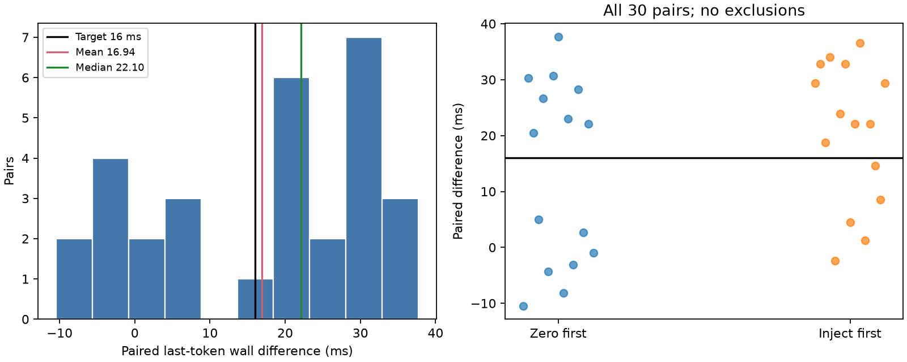

# A1：机制与记账结果、墙钟检测限及GPU时间线

日期：2026-11-02；报告修订r2。**机制/记账检查通过；墙钟定量等效未建立，当前样本功率不足，保留 inconclusive。** 正式六条件的±10%界、30对固定预算和全部样本均未改变；16.94ms点估计不能标为pass。设计见[A组设计](GPU_A1_A3_EXPERIMENT_DESIGN.md)，结果见[结构化摘要](validation/gpu-a1.json)。本轮未完成独立注入器准确度校准，不宣称完整架构或真实HBF硬件已经验证。

## 1. 执行条件与两个时钟

重插桩初始试运行出现秒级跨运行差异，历史见[初始记录](GPU_A1_PILOT_RESULTS.md)。随后lean模式关闭逐窗口CUPTI活动采集及事件写入，保留同步分段、相同固定计算表及16个消费者前gate；独立先导6对后，冻结单点/多点×每gate 10/100/1000µs，每条件4次zero预热、1次model、30对zero/inject，共180对。每次新进程、模型、上下文；条件内15对zero-first和15对inject-first，固定种子打乱，条件顺序固定。无按残差剔除或追加样本。依据：正式批次的preregistration.json、六条件protocol.json及pairs.json。

墙钟用steady_clock记录请求、注入起止和token ID可交付时刻；模拟时钟通过现有TensorAccessBridge::advance_compute推进Session。model推进固定计算和预设等待；zero/inject仅推进固定计算，实际墙钟不回填。独立分析器从固定表与注入计划重算每token预期时刻，不以执行器累计数生成期望。该实验不提交HBF访存，不验证H0的访存时延。实现见[执行器](../experiments/gpu_s/native_a1.cpp)、[分段](../experiments/gpu_s/a1_segments.hpp)、[独立分析](../experiments/gpu_s/a1_analyze.py)。

## 2. 正式机制与记账结果

正式、预热及model运行完整logits与S8保留结果逐字节一致；8输出、16个gate身份及顺序一致。Session逐token时刻等于独立重算的固定计算加预设等待，整数残差为0。inject记录的实际等待均不短于目标。真实执行器拒绝缺gate、错序、错误step及非法mode四类配置，没有正常summary。后置gate另有6对试采，但第一枚token无计划注入不等于统计零效应已被充分证明。依据：[验证摘要](validation/gpu-a1.json)、正式analysis.json及negative/late批次。

### 2.1 补充zero/inject full-CUPTI配对

新批次 `output/gpu-a1/20261102-timeline-002/` 使用同一新版二进制，按zero、inject各运行一次，均保留完整活动和API记录，inject每gate目标1ms。该二进制仅为审计在gate处新增CUPTI域起止标记，旧正式样本与其二进制快照保留不变。两轮完整logits与正式记录一致，CUPTI dropped=0。

两个运行各16个gate窗口，kernel/memcpy/memset活动与窗口交集数均为0；每个后置消费者kernel均在gate结束后启动，其活动关联的成功CUDA提交位于gate返回后开启的node窗口内。起止标记和活动比较都在CUPTI时间域；steady_clock仅记录实际忙等待，不与CUPTI绝对时刻相减。依据：[逐门窗口](validation/gpu-a1/timeline-windows.csv)、[完整时间线摘要](validation/gpu-a1/timeline.json)、补充批次audit.json和原始记录。

### 2.2 逐门pre/gate/post分解

对每门定义：pre=前一GPU活动结束至gate开始；gate=注入窗口本身；post=gate结束至消费者首个kernel启动；总GPU空隙gap=pre+gate+post。前一活动按窗口前的活动ID独立选取，不按时间筛掉可能重叠的活动。各项使用同一CUPTI域，逐门分解整数残差为0。下表为inject−zero，单位ms，16门的描述统计；这些门共享同一对运行，不当作16个独立重复实验。

| 分项 | 每门均值 | 每门中位数 | 最小—最大 | 16门合计 |
|---|---:|---:|---:|---:|
| Δpre | 0.351750 | 0.292496 | −0.187215—1.015305 | 5.628001 |
| Δgate | 0.999844 | 0.999900 | 0.999300—1.000300 | 15.997500 |
| Δpost | 0.383279 | 0.290131 | −0.003511—1.420827 | 6.132461 |
| Δ总gap | 1.734873 | 1.582626 | 0.808974—3.330537 | 27.757962 |

因此，**注入窗口的gap增加约W：Δgate均值0.999844ms，对比W=1ms，相差−0.156µs；合计15.9975ms，对比16ms，相差−2.5µs**。此句只描述本次审计对的注入窗口。若gap指完整的两次GPU活动之间空隙，则其增量还包含Δpre和Δpost，本次平均1.734873ms，不能写成完整gap≈W，也不能以gate局部结果替代token墙钟等效验收。全部逐门差分见[配对CSV](validation/gpu-a1/timeline-paired.csv)。

## 3. 小剂量：检测能力与有效分辨率

正式预登记判定仍为：paired token相对请求墙钟差减去此前实际注入时长，计算均值残差的Student-t区间，Bonferroni控制48个终点名义家族95%覆盖，要求区间全部落在累计目标±10%内。全部48个终点均为inconclusive，未改变历史结果。[完整逐token统计](validation/gpu-a1/dose-summary.csv)。

对累计目标≤1.6ms的条件，本次报告重点转为检测能力，不再以追加采样追求原±10%等效。下表X为最后token残差区间半宽，是本轮配对方法的经验精度尺度；逐token不同X均在CSV内。

| 注入方式 | 每gate目标 | 至末token累计目标 | X：调整后CI半宽 | 检测表述 |
|---|---:|---:|---:|---|
| 单点 | 10µs | 0.01ms | 15.081ms | 目标低于有效分辨率，不可测 |
| 单点 | 100µs | 0.1ms | 11.302ms | 目标低于有效分辨率，不可测 |
| 单点 | 1000µs | 1ms | 8.587ms | 未分辨出目标剂量的墙钟增量 |
| 多点 | 10µs | 0.16ms | 13.127ms | 目标低于有效分辨率，不可测 |
| 多点 | 100µs | 1.6ms | 9.758ms | 目标低于有效分辨率，不可测 |

10µs/100µs在本次墙钟与注入器联合测量路径的**有效分辨率**下不可测；这不表示steady_clock的时间戳刻度大于这些值，也不表示已独立测定注入器硬件精度。未完成注入器准确度校准，不能把可记录微小时间戳当作相同量级的定量效应已可辨识。

“未检测到≥X的延迟”若用于本报告，只能表示以X标注的本轮检测能力，不能解释为已排除所有≥X的真实延迟。CI半宽本身不是效应上界：界限还依赖区间中心，若要声称排除某个正延迟须使用适当的单侧上界。因此本报告采用“未分辨出目标剂量；检测精度尺度X”，同时完整给出区间中心与上下界，避免超过证据范围。

## 4. 16ms条件独立报告

多点每gate1ms，16门累计目标16ms，30对原始token墙钟差：**均值16.936087ms（目标的1.0585倍，约1.06×）、中位数22.097150ms**。中位数比目标高6.097150ms（约38.1%）；不能只报告较接近目标的均值。[全部30对与order](validation/gpu-a1/multi-16ms-distribution.csv)、[统计摘要](validation/gpu-a1/reporting-summary.json)。

| order | 对数 | 均值ms | 中位数ms | 最小—最大ms |
|---|---:|---:|---:|---:|
| zero先运行 | 15 | 13.323193 | 20.495100 | −10.435500—37.692900 |
| inject先运行 | 15 | 20.548980 | 22.102400 | −2.353800—36.510500 |

原始配对差呈宽分布，两种order均有负差值；总体P10=−3.240060ms、P25=3.111175ms、P75=29.380400ms、P90=32.982570ms。两个order均值相差约7.226ms，说明不能忽略运行先后分层；本次未对order差异另作显著性或因果归因。均值低于中位数，与低端及负值样本拉低均值一致；保留所有样本，不将负差值解释为注入产生负等待。

相对于实际累计等待的平均残差约0.935ms，调整后区间[−8.984,10.854]ms；远未落入±1.6ms界。因此墙钟定量等效未建立，功率/精度不足，16.94ms点估计不是pass。mean/median与宽分布必须共同解释。图表由[重报告脚本](../experiments/gpu_s/a1_rereport.py)生成。

## 5. 产物、复现与限制

正式批次 `output/gpu-a1/20261102-formal-001/` 保留预登记、全部原始记录、pairs.json、旧analysis.json及原版源码/二进制快照和SHA256；本轮只新增报告及审计，不重采正式180对。新时间线配对位于 `output/gpu-a1/20261102-timeline-002/`，含新二进制、源码、配置、原始CUPTI/API、逐门分解及哈希清单。结构化摘要为仓库可审阅副本，原始大文件未上传GitHub。

[时间线脚本](../experiments/gpu_s/a1_timeline.py)负责新配对，[归档审计](../experiments/gpu_s/a1_timeline_archive.py)核对空窗、后置kernel、计数和分解，[重报告脚本](../experiments/gpu_s/a1_rereport.py)复算原始样本统计。脚本冻结了本批次路径，重跑必须更换输出目录。旧正式采集与本轮审计二进制不同且分别保存，不以新版本替代旧身份。

Student-t区间依赖配对独立性与均值分布近似，漂移、宽尾及固定条件顺序仍有限制。单对full-CUPTI只能支撑该对局部时间线事实，不能建立稳定的总体Δgap；未校准注入器限制小剂量定量解释。后续若追求墙钟等效，应以新协议研究同进程/上下文复用及注入器准确度，保留本轮inconclusive与原10%界，不事后修改标准。
