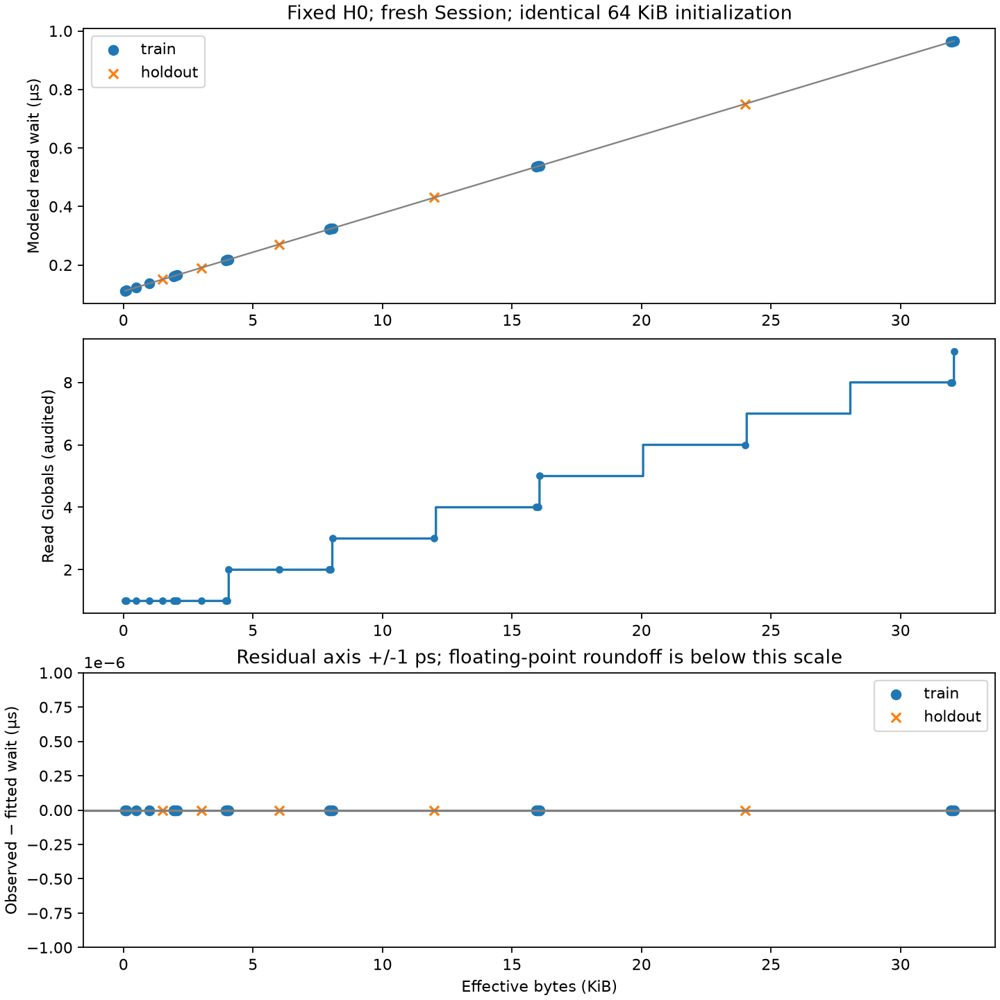

# A3：H0工作量独立审计与尺寸响应

日期：2026-11-03；完成批次 `output/gpu-a3/20261103-scan-002/`。**独立工作量审计通过；预登记候选响应模型的5个留出点通过5%相对误差判据。** 26个条件各运行3个新Session，共78次，所有访问成功并排空，同条件的后端统计、桥接事件及有效配置逐字节一致。依据：[结果](validation/gpu-a3.json)、[计数审计](validation/gpu-a3/counts-result.json)、[全部测量](validation/gpu-a3/measurements.csv)。

## 1. 条件和适用范围

使用S8保存的同一份未校准[H0配置](validation/gpu-a3/H0.ini)，经真实TensorAccessBridge→SimulationSession→HostDriver→DeviceDriver执行；无需GPU。每例新建Session，以普通写完整初始化同一个65536B区域，随后只提交一次父读，计算推进为0。初始化后请求t0统一为5775275ps，初始化写不计入读等待及读流量。这里的初始状态由上述初始化流程决定，未人工清空缓存，不称为真实硬件的冷/热状态。[冻结协议](validation/gpu-a3/protocol.json)、[执行器](../experiments/gpu_a3/scan.cpp)。

区域source_offset=128B、valid/registered_bytes=65536B、global_base=0、content=1，单channel，64B交织。桥按请求起点每4096B切Global，Host再切64B片段。H0读分派阈值32条，驻留上限256片段。4096B Global边界不保证与local DLU页界重合，非零偏移子例专门检查这一点。[区域和请求计划](validation/gpu-a3/plan.json)、[桥源码](../third_party/HBF-EventLab/src/adapters/tensor_access_bridge.cpp)、[Host拆分](../third_party/HBF-EventLab/src/host/global_request_splitter.cpp)、[交织映射](../third_party/HBF-EventLab/src/policies/round_robin_interleaver.cpp)。

首次批次001在源码清单预检中止，没有运行扫描：封存清单之外新增了两个实验记录归档工具。检查确认无任何旧封存文件变化，全部封存产物校验通过。批次002仅允许这两项明确的新增工具，保存异常清单与理由，并记录实际链接库SHA256；不接受其他新增或旧文件变化。原预检中止记录及完整dependency-build-identity.json保留。

## 2. 独立计数合同与实际检查

Python参考从原始请求和区域求交集，将source偏移映射到Global地址；独立生成每个4096B请求块、块内64B片段及其预期地址。期望文件在执行后端之前保存，不读取后端统计生成期望，也不调用被测桥、splitter或interleaver实现。[独立预测与审计](../experiments/gpu_a3/run.py)。

实际检查包括：映射偏移和有效字节；每父读的独立预期Global数与登记顺序；每Global字节与片段地址；所有读片段无遗漏重复；完整初始化写地址覆盖；每读attempt与工作ID、地址归属一致；Host内容检查成功；父完成等于最大子完成；子完成恰好一次；全部成功和最终排空。统计计数仅作为被比较值。全部78例通过。[计数结果](validation/gpu-a3/counts-result.json)、[补充归属审计](validation/gpu-a3/supplemental-audit.json)。

对真实记录副本构造6类负控：缺片、重复片段、错地址、错误Global归属、错误Global长度、Host内容检查失败；独立审计器全部拒绝。负控副本位于批次negative目录，不是声称真实后端发生过这些故障。[负控结果](validation/gpu-a3/counts-result.json)。

## 3. 尺寸矩阵及响应

冻结19个拟合点，覆盖64B至32832B，围绕2048、4096、8192、16384、32768B取合法前/上/后点；5个留出尺寸为1536、3072、6144、12288、24576B。另有offset64和left_clip两例，仅作地址/交集检查，不参与拟合。每例重复3次；预期文件、尺寸用途和模型在执行前冻结。[协议](validation/gpu-a3/protocol.json)、[计划](validation/gpu-a3/plan.json)。

| 有效读字节 | 独立Global数 | 独立64B片段数 | 模拟等待ps | 模拟等待µs |
|---:|---:|---:|---:|---:|
| 64 | 1 | 1 | 112201 | 0.112201 |
| 4096 | 1 | 64 | 217222 | 0.217222 |
| 8192 | 2 | 128 | 323910 | 0.323910 |
| 16384 | 4 | 256 | 537286 | 0.537286 |
| 32832 | 9 | 513 | 965705 | 0.965705 |

上表来自[测量CSV](validation/gpu-a3/measurements.csv)，三次重复完全相同。最大尺寸出现5次容量背压拒绝后继续并成功，不能据此认定背压没有成本；只能说明本次最终时延仍落在观察到的响应关系上。



## 4. 预登记拟合、留出误差及误差带

候选模型在2048、4096、8192、16384B分为5个右闭区间，各自拟合截距和斜率，允许段间不连续；断点依据为分派阈值、Global/页粒度和驻留边界，是结构性候选，不预言实际拐点。只用19个训练尺寸拟合，5个留出点每点相对误差≤5%才通过。5%是本轮工程预测目标，不是硬件精度标准。[冻结协议](validation/gpu-a3/protocol.json)。

| 留出字节 | 实际等待ps | 预测等待ps（整数显示） | 相对误差 |
|---:|---:|---:|---:|
| 1536 | 150542 | 150542 | <7×10⁻¹⁶ |
| 3072 | 190550 | 190550 | <7×10⁻¹⁶ |
| 6144 | 270566 | 270566 | <7×10⁻¹⁶ |
| 12288 | 430598 | 430598 | 0 |
| 24576 | 750662 | 750662 | <7×10⁻¹⁶ |

所有留出点通过，最大浮点绝对残差约4.66×10⁻¹⁰ps。这是浮点拟合算术残差，不是模拟器或硬件具有亚皮秒测量准确度。误差带定义为各段训练最大绝对残差包络，最大约6.99×10⁻¹⁰ps；因重复为确定性结果，不绘制统计置信区间，误差带也不代表硬件误差界。[完整拟合及逐点误差](validation/gpu-a3/fit.csv)、[系数](validation/gpu-a3/result.json)。

五段斜率和截距在浮点精度下相同，本次没有观察到候选边界上的折点。因此应报告“所测范围内呈单一直线响应”，不能强称有显著分段拐点。

**事后简化**得到 `T_ps = 110534 + 1667 × (有效字节 / 64)`；对24个主尺寸的72条重复记录用整数重算，残差均为0ps。这一表达式来自数据拟合后的归纳，不是事先由全部调度规则推导的服务时间定理，也不是额外独立验证。[事后整数检查](validation/gpu-a3/posthoc-linear-check.json)。

## 5. 偏移与交集子例

offset64将读起点移到区域内64B，保持8192B长度；独立预测仍为2个请求相对Global、128个片段，但跨越3个local DLU。实测等待323910ps，与零偏移8192B相同；读路径记录的sense次数由2增至3。说明当前例中内部路径计数改变未必改变父读最终时延，不能据此推论所有地址偏移无影响。

left_clip的源请求为[64,4224)，与区域源范围[128,65664)交集为[128,4224)，有效4096B；映射到Global[0,4096)，1个Global、64个片段，等待217222ps。注册与有效区域在本轮均65536B，没有填充；不以源请求4160B误计有效读字节。[计划](validation/gpu-a3/plan.json)、[测量](validation/gpu-a3/measurements.csv)。

## 6. 结论与复现

本轮在固定H0、单父读、固定地址基线和相同64KiB初始化状态下，真实后端工作量与独立预测一致；64..32832B的已测主尺寸表现为线性延迟响应，预登记候选模型在5个留出点通过。该结论限定于这些输入和状态，不校准真实HBF参数，不保证所有尺寸、并发度、地址或缓存状态同样线性，也不以symbolic内容核验宣称真实NAND字节搬运。

从Visual Studio x64开发者PowerShell执行：

```powershell
./experiments/gpu_a3/build.ps1
python experiments/gpu_a3/run.py --study output/gpu-a3/<new-batch>
python experiments/gpu_a3/analyze.py --study output/gpu-a3/<new-batch>
```

使用新目录，不使用Python `-O`。需要保留的S8 H0和已封存EventLab依赖库。批次保存输入、独立期望、完整统计与桥事件、负控、配置、源码/二进制快照、拟合和SHA256清单；[执行说明](../experiments/gpu_a3/README.md)。仓库保存本报告、图表及结构化结果副本。没有GPU快照，尚未上传GitHub。
